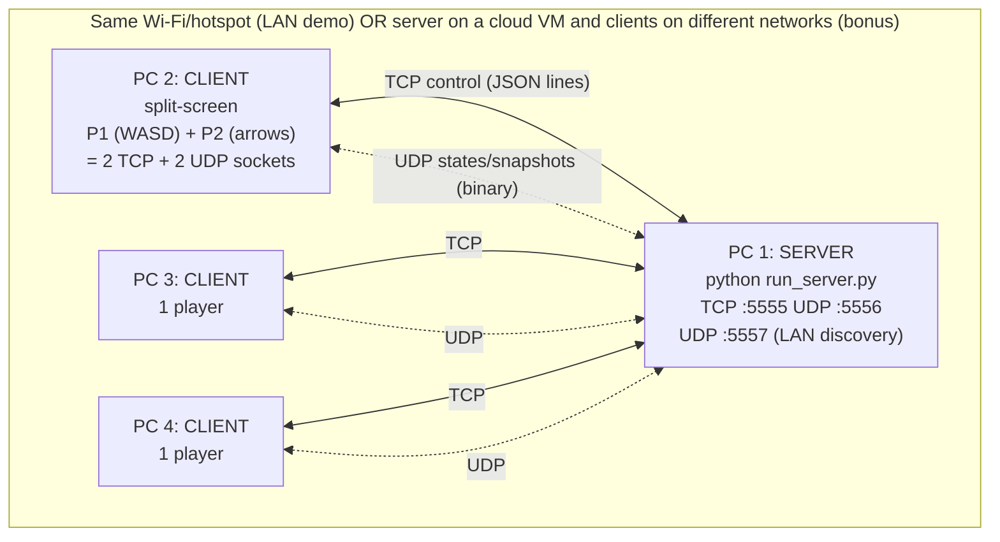
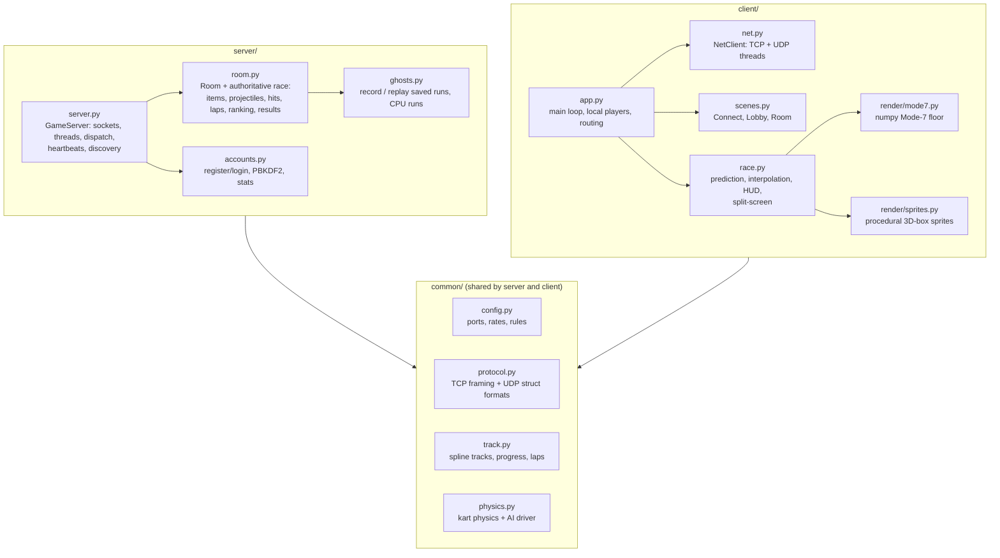
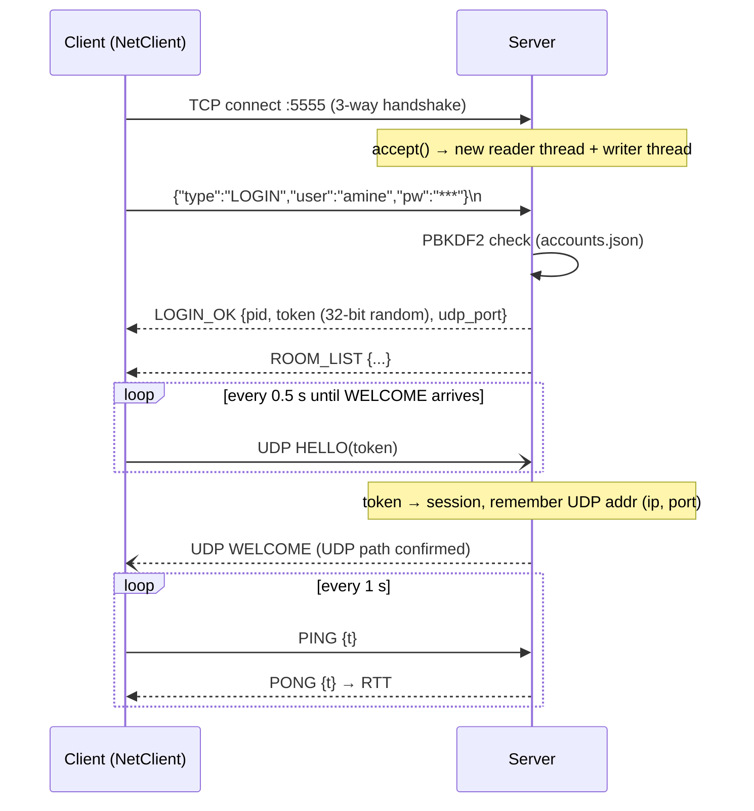
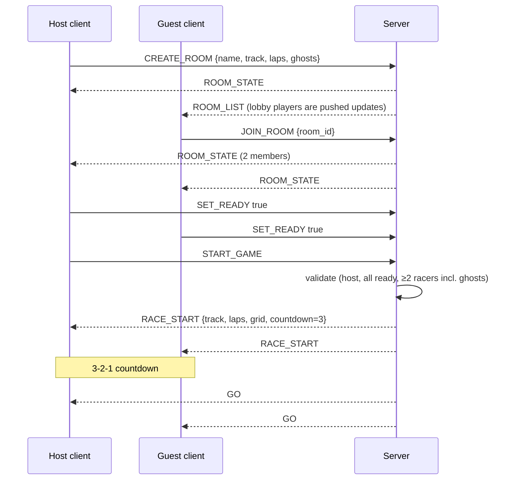
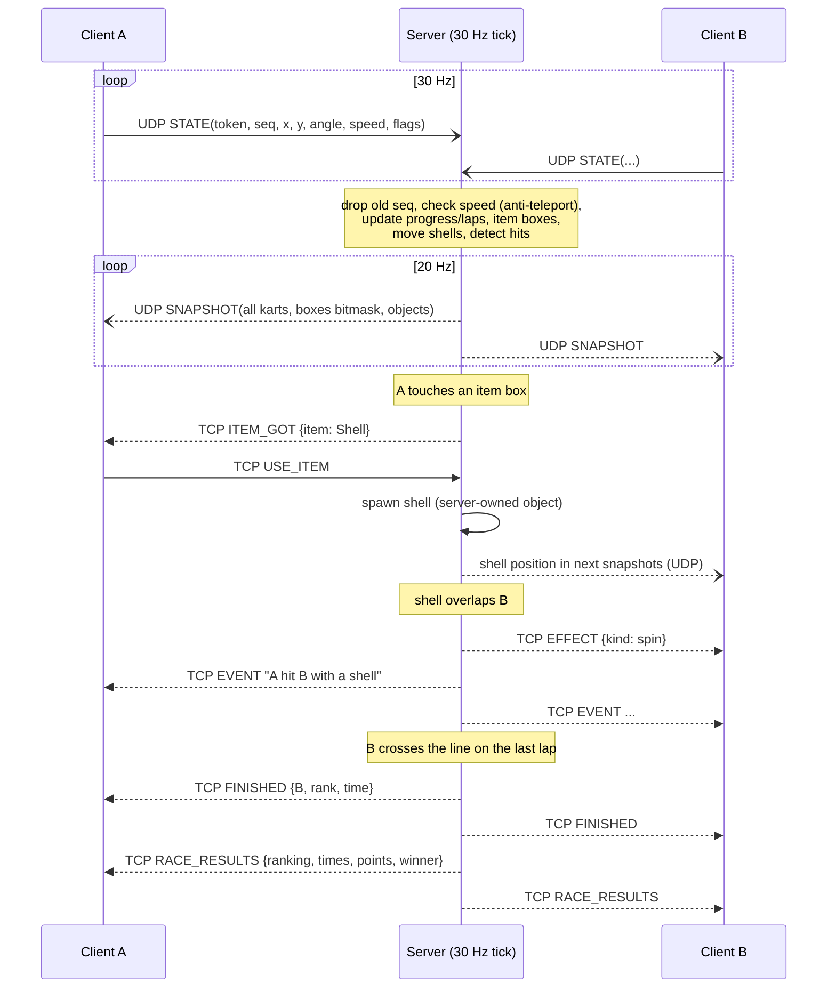
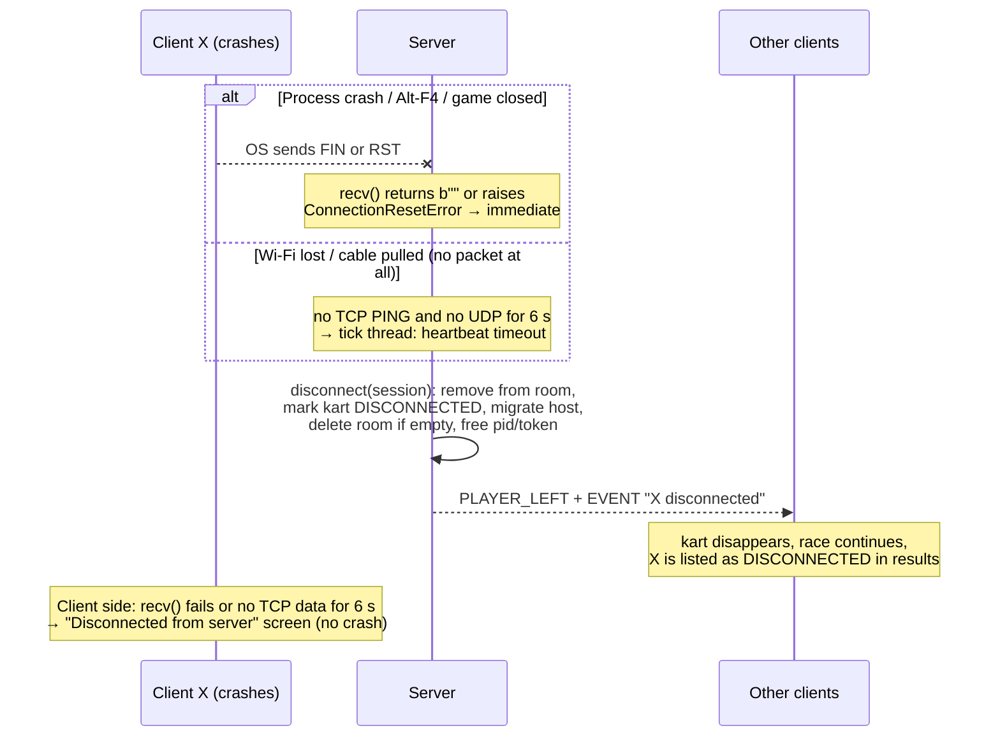
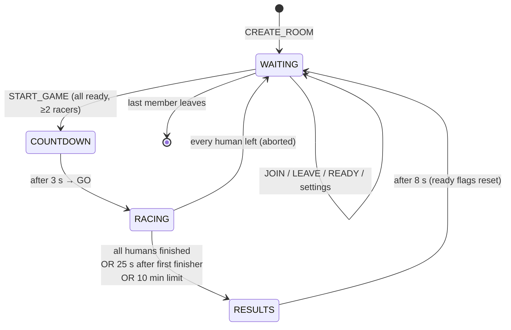
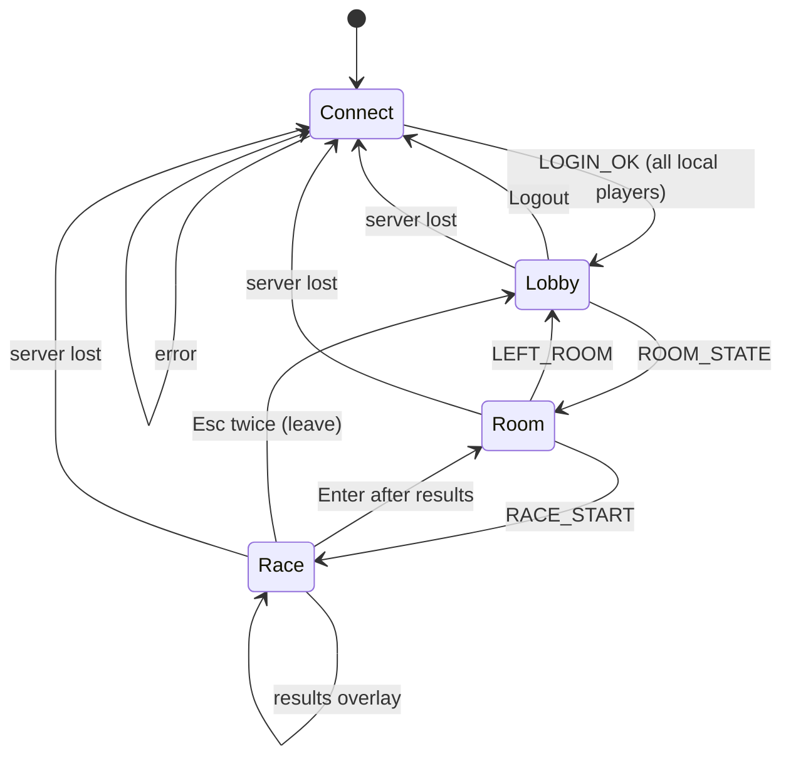
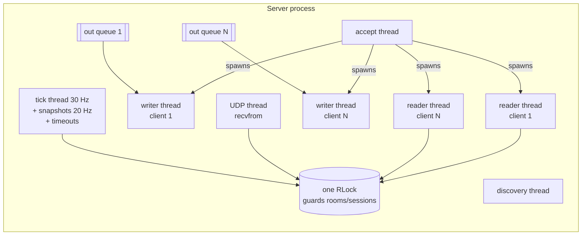
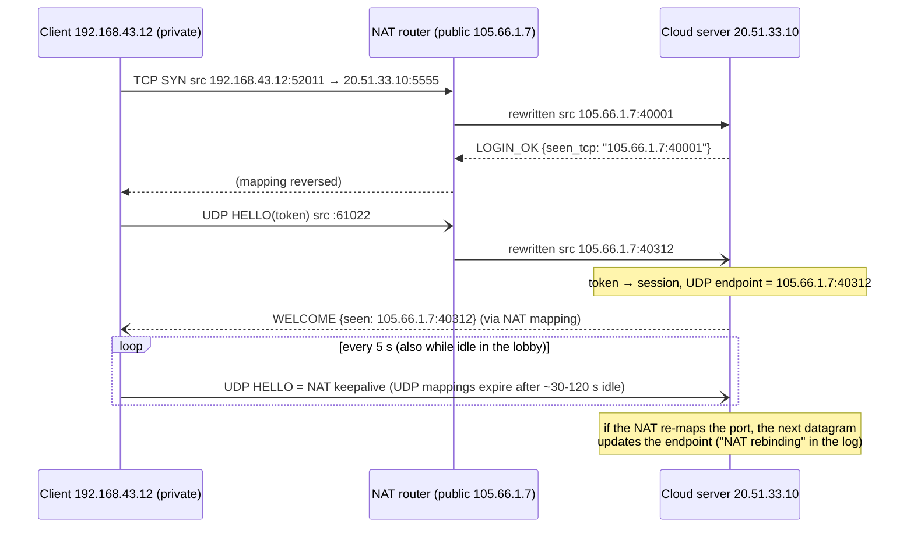

# Turbo Kart Arena: Architecture

A competitive online kart racer (Mode-7 pseudo-3D, items, abilities) built on **raw TCP and UDP sockets** in Python.
One authoritative server, any number of clients. Each client can host **1 or 2 local players** (split-screen),
and a single player can race **ghosts**: replays of saved runs by other players (or CPU runs if none exist yet).

> Diagrams are written in Mermaid. They render on GitHub, in VS Code (Markdown Preview Mermaid extension), and at https://mermaid.live.

---

## 1. Deployment (demo day: 4 PCs)



## 2. Software components



## 3. Protocol choice: which interaction uses TCP or UDP, and why

| Interaction | Protocol | Why |
|---|---|---|
| Register / login | **TCP** | Must arrive exactly once and in order. Losing a login packet would leave the player stuck. Needs a request/response. |
| Lobby room list, create/join/leave room, ready, settings | **TCP** | Low-rate state changes that must not be lost. Order matters (join before ready). |
| Race start, countdown, GO | **TCP** | Everybody must receive it. A lost "GO" would freeze a player. |
| **Kart position / speed / angle (client → server, 30 Hz)** | **UDP** | Sent continuously, and each packet supersedes the previous one. A lost packet is replaced 33 ms later, so retransmitting it (TCP) would only add delay and head-of-line blocking. Stale packets are dropped using a sequence number. |
| **World snapshots (server → clients, 20 Hz)**: all karts, item boxes, bananas, shells | **UDP** | Same reasoning: only the newest state matters. The client interpolates between snapshots, so a lost one is invisible. |
| Item pickup (`ITEM_GOT`), item use (`USE_ITEM`), hits (`EFFECT spin`), shield | **TCP** | Discrete one-time events that change the game result. They must not be lost (an item that disappears, or a hit that never registers). They are rare (a few per minute), so TCP's cost is irrelevant. |
| Lap / finish (`FINISHED`), results, scores | **TCP** | Final results must be reliable and identical for every player. |
| Heartbeat PING/PONG (1 Hz) | **TCP** | Detects dead connections. Also measures the round-trip time (RTT) shown in the F3 overlay. |
| UDP HELLO / WELCOME (+ keepalive every 5 s) | **UDP** | Lets the server learn the client's **public** UDP address (`ip:port` after NAT) and confirms the UDP path is open through firewalls. Repeating it keeps the NAT mapping alive. WELCOME tells the client which public endpoint the server saw. |
| UDP PING/PONG echo (no login) | **UDP** | Used by `tools/netcheck.py` to measure UDP RTT, jitter and loss to the server. |
| LAN server discovery | **UDP broadcast** | TCP cannot broadcast. One datagram to 255.255.255.255:5557 and every server on the LAN answers. |

**Summary:** *TCP for anything that must arrive (state changes, events, results). UDP for high-frequency state where only the latest value matters.*

## 4. Message flows

### 4.1 Connect, login and UDP binding



### 4.2 Lobby → room → race start



### 4.3 Real-time race loop + items



### 4.4 Disconnection handling



## 5. State machines

### Room



### Client scenes



## 6. Wire formats

### TCP: newline-delimited JSON
TCP is a **byte stream** with no message boundaries: one `recv()` can return half a message or three messages.
Each message is therefore one JSON object followed by `\n`, and `LineFramer` buffers bytes until a full line is available.

```
{"type":"LOGIN","user":"amine","pw":"secret"}\n
{"type":"ITEM_GOT","item":3,"count":1}\n
```

### UDP: fixed binary layouts (`struct`, network byte order)
Each datagram is self-contained, at most about 400 bytes (well under the ~1200-byte safe MTU payload).

| Packet | Layout | Size |
|---|---|---|
| Header (all) | `magic "TK"` (2s), `version` (B), `type` (B) | 4 B |
| HELLO (C→S) | header + `token` (I) | 8 B |
| WELCOME (S→C) | header + observed IPv4 (4s), observed port (H) | 10 B |
| PING / PONG | header + `seq` I, `timestamp` d | 16 B |
| STATE (C→S) | header + `token` I, `seq` I, `x` f, `y` f, `angle` f, `speed` f, `flags` B | 29 B |
| SNAPSHOT (S→C) | header + `seq` I, `race_time` f, `boxes` I (bitmask), `n_karts` B, `n_objs` B | 18 B |
| … per kart | `pid` B, `x` f, `y` f, `angle` f, `speed` f, `lap` h, `rank` B, `flags` B | 21 B |
| … per object | `kind` B, `id` H, `x` f, `y` f | 11 B |

Kart flags: `1 boost, 2 spin, 4 shield, 8 ghost, 16 finished, 32 disconnected`.
6 karts + 10 objects ≈ 260 bytes per snapshot × 20 Hz ≈ 5 KB/s per client.

**Sequence numbers** make UDP usable. Receivers keep the highest `seq` seen and drop anything older (reordered or duplicated datagrams). Gaps in `seq` are counted as lost packets, and the F3 overlay shows the loss %.

## 7. Concurrency model (simultaneous players)



* **One thread per TCP client** for reading, so a blocking `recv()` only blocks that client.
* **Outgoing TCP goes through a per-client queue + writer thread.** The game logic never calls `sendall()` itself, so a slow or frozen client can't stall the tick loop or other players.
* All game state is modified under **one lock**. Every action (two players grabbing the same item box in the same tick, for example) is applied in a single order, and the first one wins.
* The server is **authoritative** for everything shared: item boxes, item rolls, projectiles, hits, lap counting, ranking, results.

## 8. Latency handling

| Technique | Where | Effect |
|---|---|---|
| **Client-side simulation** of your own kart | `race.py` + `physics.py` | Steering feels instant even with 100 ms ping. |
| **Server validation** of client states | `room.on_state` | Rejects stale `seq` and teleports (distance > max speed × dt). |
| **Entity interpolation** of other karts | `race.interpolate` | Remote karts are drawn 100 ms in the past, blended between two snapshots, so movement is smooth even with jitter or loss. |
| **Server clock offset estimation** | `race.interpolate` | Snapshots carry the server race time. The client estimates the offset and interpolates on the server timeline. |
| TCP_NODELAY | both | Disables Nagle's algorithm, so small event messages are sent immediately. |

## 9. Split-screen design

Each local player is a `LocalPlayer` with **its own `NetClient` (its own TCP and UDP sockets, its own login)**.
To the server, a split-screen player is indistinguishable from a player on another PC. This keeps the server simple and gives these combinations for free:

* 2 players on one PC playing online,
* 4 players on 2 PCs (2 + 2),
* 3 PCs with 1 or 2 players each (up to 6 per room),
* 1 player alone against ghosts.

When Player 1 enters a room, the client automatically sends `JOIN_ROOM` for Player 2. The screen is split top and bottom, with one Mode-7 viewport per local player.

## 10. Ghosts ("saved players")

* During a race the server samples each human kart every 0.1 s (`[t, x, y, angle]`).
* When a **registered** player finishes, the run is saved to `data/ghosts/<track>_<laps>laps.json`. The best 6 runs are kept, at most 2 per player.
* When a room has "Ghost opponents = N", the server loads the N best runs and replays them as karts. Their positions are interpolated from the samples and sent in the normal UDP snapshots, with the `ghost` flag set.
* Ghosts are pass-through: they cannot be hit and cannot take item boxes. They **count in the ranking with their recorded time**.
* If no saved runs exist yet, the server generates **CPU runs** by simulating the AI driver offline (about 0.1 s each), so solo play always works.

## 11. Cross-network play (bonus): cloud server

Full step-by-step guide: **[CLOUD_DEPLOY.md](CLOUD_DEPLOY.md)**.

The server runs on a **cloud VM with a public IP** (Ubuntu, systemd service). Clients on any network (university Wi-Fi, phone 4G hotspot, home) connect **outbound** to it, which every NAT allows.



What the code does for internet conditions:

| Problem on the internet | Handling in the code |
|---|---|
| Clients are behind NAT, and their private IP is useless to the server | The server sends to the **source address it observes** on each datagram, never to an address the client claims |
| Idle UDP NAT mappings expire | UDP `HELLO` keepalive every 5 s (`UDP_KEEPALIVE`) |
| The NAT changes the mapped port (rebinding) | The endpoint is updated on every valid packet and logged |
| Higher, variable latency (jitter) | Local simulation of your own kart, plus an **adaptive interpolation delay** (100-300 ms, based on snapshot jitter) for the others |
| Loss and reordering | UDP sequence numbers, plus TCP for every event that must arrive |
| Public ports may differ from the defaults (port mapping, Docker) | The client accepts `host:tcp:udp` and uses the configured UDP port, not the one the server announces |
| A public server can be abused | Session caps (64 total, 8 per IP), login deadline, 64 KB frame cap, non-amplifying UDP echo |

Tools: `tools/netcheck.py` (TCP/UDP reachability, RTT, jitter, loss) and `tools/netem_proxy.py` (local emulation of delay, jitter and loss).

## 12. Robustness checklist

* Malformed JSON lines are ignored, and unknown message types get an `ERROR` reply. An exception inside a handler is caught and logged and never kills the server.
* Malformed or foreign UDP datagrams are rejected by magic/version/size checks.
* Room actions are validated (host-only settings and start, room full, race in progress, all ready, ≥2 racers).
* A user cannot be logged in twice. Passwords are stored as salted PBKDF2-SHA256 hashes, never in plain text.
* The Windows-specific UDP `WSAECONNRESET` (an ICMP "port unreachable" from a closed client) is disabled or ignored.
