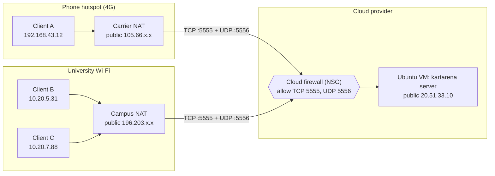

# Bonus: Cross-network multiplayer with a cloud server

**Goal:** the server and the three clients are **not on the same network**.
We run the server on a cloud VM with a public IP. Each client connects from any network it happens to be on (university Wi-Fi, a phone's 4G hotspot, home internet) and nothing has to be installed on the client side.

---

## 1. Why this is not trivial, and why a public server solves it



* Client PCs have **private addresses** (10.x, 172.16-31.x, 192.168.x). These are not routable on the internet, and the NAT router in front of them **drops unsolicited inbound packets**. A server running on a teammate's laptop could therefore never be reached from another network.
* A cloud VM has a **public IP**, and the cloud firewall can be opened for our ports. Every client **initiates** the connection outbound, which NAT always allows.
* **TCP through NAT:** the router rewrites `10.20.5.31:51234 → 196.203.x.x:40001` and keeps the mapping while the connection is open.
* **UDP through NAT** is subtler. UDP has no connection, so the router keeps a mapping only for a while after the last outgoing packet (often 30-120 s).
  * The client sends a UDP `HELLO` with its session token. The server learns the **public `ip:port` the NAT assigned** (not the private one) and sends all snapshots there.
  * The client repeats `HELLO` **every 5 s as a keepalive** (`UDP_KEEPALIVE`), so the mapping stays alive while players sit in the lobby.
  * If the NAT changes the port anyway (*NAT rebinding*), the next packet carries the new address. The server updates it and logs `UDP endpoint changed ... (NAT rebinding)`.
  * The server replies to `HELLO` with `WELCOME`, which contains the public endpoint it observed. The client shows it in the lobby status bar and in the F3 overlay, which makes the NAT translation visible during the demo.
* **Internet latency and jitter** (30-150 ms instead of 1 ms):
  * Your own kart is simulated locally, so steering is never delayed.
  * Other karts are interpolated. The interpolation delay **adapts to the measured jitter** (100 ms on a LAN, up to 300 ms on a bad 4G link), so remote karts move smoothly instead of stuttering.
  * Lost or reordered UDP packets are absorbed by sequence numbers and interpolation.
  * Items, hits and results use TCP, so they are never lost.

## 2. Create the VM (Azure for Students, free, no credit card)

Any provider works; the table in §6 shows where the firewall settings are on each. These steps use Azure, which offers free student credit.

1. Go to https://azure.microsoft.com/free/students, activate it with your university e-mail, then open https://portal.azure.com.
2. **Create a resource → Virtual machine**:
   * Image: **Ubuntu Server 24.04 LTS** (22.04 also works)
   * Size: **B1s** (1 vCPU, 1 GB RAM is plenty; the server uses about 30 MB)
   * Region: the closest one to you, for the lowest ping (e.g. *France Central*, *Italy North* or *West Europe* from North Africa or Europe)
   * Authentication: **SSH public key**, username `azureuser`. Download the generated `.pem` key and keep it.
   * Inbound ports: allow **SSH (22)**.
3. When it's deployed: **VM → Networking → Add inbound port rule**, twice:
   | Name | Protocol | Destination port | Source | Action |
   |---|---|---|---|---|
   | kart-tcp | **TCP** | 5555 | Any | Allow |
   | kart-udp | **UDP** | 5556 | Any | Allow |
4. Copy the VM's **Public IP address** (e.g. `20.51.33.10`). You can also set a *DNS name label* to get `kartarena.francecentral.cloudapp.azure.com`.

## 3. Install the server (one command from Windows)

From the project folder on your PC:

```powershell
powershell -ExecutionPolicy Bypass -File deploy\upload.ps1 -Target azureuser@20.51.33.10 -Key C:\path\to\kart-vm_key.pem
```

This packs `common/`, `server/` and `run_server.py`, uploads them with **scp**, then runs `deploy/setup_server.sh` on the VM over **ssh**. The setup script:

* installs Python 3 (the server needs only the standard library),
* copies the code to `/opt/kartarena` and runs it as an unprivileged `kart` user,
* installs the **systemd** service `kartarena` (starts at boot and restarts if it crashes),
* opens the ports in the VM's own firewall (ufw or iptables) if one is active.

Finally `upload.ps1` runs `tools/netcheck.py` against the VM.

If you'd rather do it by hand: copy the project to the VM, then run `sudo bash deploy/setup_server.sh`.
With Docker: `docker build -t kartarena . && docker run -d -p 5555:5555/tcp -p 5556:5556/udp -v kart-data:/app/data kartarena`.

Useful commands on the VM (`ssh -i key.pem azureuser@20.51.33.10`):

```bash
sudo journalctl -u kartarena -f       # live server log (logins, UDP endpoints, races, disconnections)
sudo systemctl restart kartarena
sudo systemctl stop kartarena
```

## 4. Check the path from each client network

```bash
python tools/netcheck.py 20.51.33.10
```

Example output from a phone hotspot:

```
[TCP ] connected in 48.3 ms (3-way handshake ~ 1 RTT)
       local endpoint 192.168.43.12:52011  <- private address: you are behind NAT ...
[TCP ] PING/PONG RTT  min 45.1 ms  avg 52.7 ms  max 71.0 ms
[UDP ] received 100/100  loss 0.0%  reordered 0
[UDP ] RTT  min 44.0 ms  avg 50.2 ms  max 69.8 ms  jitter 4.1 ms
VERDICT: OK - both channels work, the game will run over this path.
```

If TCP works but UDP doesn't, the **UDP 5556 rule** is missing in the cloud firewall, and the karts would not move.

## 5. Demo script (bonus)

1. The server is already running on the VM. Show `sudo journalctl -u kartarena -f` on the projector or in an ssh window.
2. Put the three client PCs on **three different networks**, for example:
   * PC A on the university Wi-Fi,
   * PC B on a phone's 4G hotspot,
   * PC C on a second phone's hotspot or a home connection.
3. On each client, run `python run_client.py --host 20.51.33.10` (or type the IP; `host:tcp:udp` is accepted too). Log in.
4. Point out in the server log that each player arrives from a **different public IP**, and that the UDP endpoint port is NAT-assigned.
5. Point out the lobby status bar on each client: `you are 192.168.43.12, server sees 105.66.x.x:40312`. Private and public addresses differ, which means the client is behind NAT.
6. Race. Press **F3** to show RTT (tens of ms instead of ~1 ms), jitter, the adaptive interpolation delay, and UDP loss.
7. Disconnection over the internet: switch PC B's hotspot off mid-race. The server logs `heartbeat timeout (6s silent)` and the others see "B disconnected".

You can rehearse at home without a VM: `tools/netem_proxy.py` adds delay, jitter and loss locally, so you can see how the game behaves on a bad link (e.g. `--delay 70 --jitter 25 --loss 8`).

## 6. Other providers (where the firewall is)

| Provider | Free option | Open TCP 5555 and UDP 5556 in… | Default user |
|---|---|---|---|
| **Azure** | Azure for Students ($100, no card) | VM → Networking → inbound port rules (NSG) | `azureuser` |
| **Oracle Cloud** | Always Free (card required) | VCN → Security List → Ingress rules. The VM's own iptables are fixed by the setup script. | `ubuntu` |
| **AWS** | Free tier, 12 months (card) | EC2 → Security Groups → Inbound rules | `ubuntu` |
| **Google Cloud** | $300 trial (card) | VPC network → Firewall → Create rule (target tag) | your Google username |
| **GitHub Student Pack → DigitalOcean** | $200 credit | Networking → Firewalls (or none by default) | `root` |

**Cost and safety:** a B1s VM costs about $8 a month, or nothing within the student credit. Stop or delete it after the demo. The server is built to be exposed to the internet:
* It accepts at most 64 sessions and 8 connections per IP.
* Unauthenticated sockets are closed after 30 s, and silent ones after 6 s.
* TCP messages are capped at 64 KB.
* Malformed packets are ignored.
* Passwords are stored as salted PBKDF2 hashes.
* The UDP echo replies with the same size as the request, so it cannot be used for traffic amplification.
